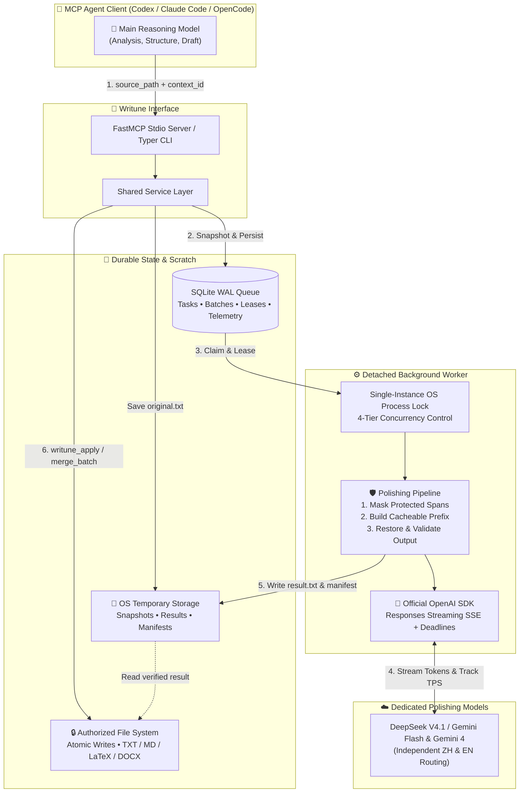

<div align="center">

<!-- Animated SVG Header Banner -->


<!-- Dynamic Typing Effect -->
<p align="center">
  
</p>

<!-- Tech & Status Badges -->
<p align="center">
  <a href="https://www.python.org/"></a>
  <a href="https://modelcontextprotocol.io/"></a>
  <a href="https://platform.openai.com/docs/api-reference/responses"></a>
  <a href="https://www.sqlite.org/"></a>
  <a href="LICENSE"></a>
</p>

<p align="center">
  
  
  
  
</p>

<!-- Navigation Bar -->
<h4>
  <a href="README.md">🇨🇳 简体中文</a> &nbsp;·&nbsp;
  <a href="INSTALL_PROMPT.md">⚡ One-Step Harness Install</a> &nbsp;·&nbsp;
  <a href="MANUAL_INSTALL.md">🛠️ Manual Install</a> &nbsp;·&nbsp;
  <a href="docs/configuration.md">⚙️ Configuration</a> &nbsp;·&nbsp;
  <a href="docs/mcp-integration.md">🔌 MCP Integration</a>
</h4>

---

</div>

> [!IMPORTANT]
> **High-IQ reasoning models such as ChatGPT excel at logic and analysis, but their prose often feels stiff, translated, and burdened with defensive filler.**
> **Writune** embeds lower-cost models that excel at natural expression, such as **DeepSeek V4.1** and the **Gemini Flash / Gemini 4 series**, directly into **Codex**, **Claude Code**, and **OpenCode** workflows—**eliminating manual copy-pasting** and sparing your main model from regenerating entire documents.

---

## ✨ Why Writune?

### 🧠 1. Pair High-IQ Reasoning with Models That Actually Sound Human

ChatGPT and Claude excel at complex reasoning, code analysis, and research design, but the papers, reports, and Chinese-language documentation they draft often contain stiff sentences and formulaic language. Copying a finished draft to another website for polishing adds work and can disrupt formatting and citations.

Writune decouples **thinking** from **writing**:
- **Main Agent:** Handles deep reasoning, structure, and initial drafting.
- **Dedicated Polishing Model:** Routes prose to fast, cost-effective models that excel at natural expression. Recommended options include **DeepSeek V4.1** and the **Gemini Flash / Gemini 4 series** (configured independently for Chinese and English primary/fallback slots).
- **Zero Copy-Paste:** Everything happens automatically within your agent workflow through file handoff.

### 💸 2. Avoid Repeated Main-Model Output Tokens

The workflow follows `source_path → async queue → result_path → deterministic apply`. The main agent coordinates work through tiny task IDs and file paths, while polished passages move directly between files without the expensive main model regenerating them.

### 🛡️ 3. Protect Technical Details & Keep Work Moving

- **Zero-Hallucination Span Protection:** Masks numerical fragments, statistical symbols, citations, LaTeX formulas, code blocks, and custom terminology before inference, then restores and validates them afterward.
- **Durable Async Queue & Fallback:** A SQLite WAL queue and a detached worker persist tasks across restarts with 4-tier concurrency limits. If upstream requests time out, `outcome="original_fallback"` safely delivers the preserved original text so document assembly never breaks.

### 📊 Workflow at a Glance

| Step | Main Agent (Reasoning) | Writune (Polishing) |
| :--- | :--- | :--- |
| **1. Draft** | Develop reasoning and structure, and draft content | Reuse shared writing context (`context_id`) across sections |
| **2. Submit** | Pass `source_path` and scene/style settings | Snapshot the source, queue the task, and immediately return `task_id` |
| **3. Polish** | Continue independent work without blocking | Call DeepSeek V4.1 / Gemini models, restore spans & validate |
| **4. Apply** | Specify the target document and placeholder | Insert, merge, or export directly to disk via atomic writes |

---

## 🎯 Use Cases & Genre Matrix

| Scenario | Scene Key | What Writune Delivers |
| :--- | :---: | :--- |
| 🔬 **SCI Manuscripts & Papers** | `sci_paper` | Section-aware rules (`Abstract`, `Results`, `Discussion`, `Methods`), a strict distinction between association and causation, and protected statistics and citations |
| 🇨🇳 **Chinese Journal Articles** | `chinese_journal` | Disciplined scholarly Chinese, consistent terminology, and removal of padded verb phrases (e.g., *进行讨论 → 讨论*) and of formulaic transitions |
| 🛠️ **Research & Tech Docs** | `technical_report` | Unambiguous presentation of system behavior, parameters, units, and versions, with observed facts clearly separated from recommendations |
| 📖 **User Manuals & Guides** | `user_manual` | Concise, actionable, step-by-step instructions that preserve exact order, conditions, and warnings |
| 💼 **Business Reports** | `business_report` | A direct professional tone, clear links between findings and implications, and preserved caveats |
| 🎓 **Academic Assignments & Essays** | `academic_assignment` / `school_essay` | Improved grammar and logical flow while preserving the student's reasoning, level, and personal voice |
| 📚 **Long Documents & Multi-Paragraph Batches** | *All Scenes* | Automatic Markdown segmentation, a shared `context_id`, per-batch concurrency limits, and source-order merging that preserves BOM and line endings |

<details>
<summary>🎨 <b>View All 6 Built-in Polishing Styles (Click to expand)</b></summary>
<br>

| Style Key | Editorial Focus |
| :--- | :--- |
| `natural` | Fluent, idiomatic wording and varied sentence rhythm without altering meaning *(Default)* |
| `concise` | Strips unnecessary words and repetition while retaining every substantive detail |
| `formal` | Maintains a consistently formal register and eliminates colloquial phrasing |
| `academic` | Precise, measured scholarly phrasing that preserves appropriate uncertainty |
| `explanatory` | Makes relationships and referents easy to follow without inventing new facts |
| `literary` | Enhances cadence and imagery where already present while respecting the author's voice |

> 💡 *Need custom house rules?* Override any built-in scene or style, or define new ones via `custom_templates` in `config.json`.

</details>

---

## 🚀 Installation & Quick Start

### ⚡ 1. One-Step Harness Installation (Recommended)

Hand **[INSTALL_PROMPT.md](INSTALL_PROMPT.md)** to your coding agent (Claude Code, Codex, or OpenCode) and say:

> *"Please execute `INSTALL_PROMPT.md` to complete Writune's isolated installation, configuration, MCP & Skill registration, and end-to-end verification."*

- **Recommended Polishing Models:** During setup, configure natural, cost-effective models such as **DeepSeek V4.1** or the **Gemini Flash / Gemini 4 series**.
- **Isolated Environment:** Installs into `.writune-venv` without touching your existing Python/Conda environments, `PATH`, or your registry.
- 🛠️ **Prefer to set things up step by step in the terminal?** See the **[Manual Installation Guide](MANUAL_INSTALL.md)**.

---

### 💬 2. Trigger Polishing in One Sentence

Once installed, **you do not need to memorize any tool names or write JSON**. Simply add **"use Writune to polish"** (or **“使用Writune润色”**) to your chat prompt:

```text
Draft the Results and Discussion sections based on our experimental data, and use Writune to polish the final manuscript.
```

Your agent will automatically draft the content, submit the file to Writune in the background, and apply the polished prose back into your document!

---

### 🔥 3. Strongly Recommended Companion Skills

Pair Writune with these two skills for a complete, publication-grade writing pipeline:

| Companion Skill | Purpose | How It Synergizes with Writune |
| :--- | :--- | :--- |
| 🏛️ **[nature-writing](https://github.com/Yuan1z0825/nature-skills/tree/main/skills/nature-writing)** | **High-Quality Academic Manuscript Structuring** | Guides the main reasoning model to build rigorous scientific arguments, structure sections, and draft high-impact manuscripts before Writune refines the prose. |
| ✂️ **[jung233/anti-defensive-writing-Skill](https://github.com/jung233/anti-defensive-writing-Skill)** | **Eliminate Defensive AI Filler & Hedging** | Strips out tedious AI throat-clearing, defensive disclaimers, and bloated meta-commentary so your drafts stay direct, confident, and incisive. |

Recommended combined prompt:

```text
Based on the experimental data, use nature-writing and anti-defensive-writing-Skill to draft the Results and Discussion sections, then use Writune to polish the final document.
```

---

## 🏗️ Architecture & Workflow



<details>
<summary>📟 <b>Prefer ASCII Diagram? (Click to expand)</b></summary>

```text
Codex / Claude Code: reasoning, content, draft
                  │ source path + writing context
                  ▼
          Writune MCP / CLI
                  │
             Shared Service
          ┌───────┴────────┐
          ▼                ▼
     SQLite queue     Authorized file operations
          │                ▲
     Detached worker       │
          │                │
     Responses API ──► Results in OS temporary storage
          │
     Dedicated polishing model
```

</details>

---

## 💻 How It Works Under the Hood (MCP Tools & API)

When triggered by **"use Writune to polish"**, your agent orchestrates the following tools automatically (you can also invoke them directly via MCP or CLI):

### 📝 1. Single-Paragraph Polish & Deterministic Apply

1. **Create Context:** `writune_create_context` stores topic, section, terminology, and writing goal into a reusable `context_id`.
2. **Submit File:** `writune_submit` queues the draft immediately:
   ```json
   {
     "source_path": "/absolute/allowed/workspace/draft.txt",
     "language": "en",
     "scene": "sci_paper",
     "style": "academic",
     "context_id": "ctx_<returned-id>"
   }
   ```
3. **Apply to Placeholder:** Place `{{WRITUNE:RESULTS}}` in the target document and call `writune_apply`:
   ```json
   {
     "task_id": "<returned-task-id>",
     "target_path": "/absolute/allowed/workspace/manuscript.md",
     "placeholder_id": "RESULTS"
   }
   ```
   *(By default, `writune_apply` writes a preview to OS temporary storage; pass `output_path` and `overwrite=true` for atomic in-place publication across **TXT, Markdown, LaTeX, and DOCX**.)*

### 📚 2. Batch Polish a Markdown Document & Merge in Source Order

Submit an entire Markdown file for automatic segmentation with a per-batch concurrency limit:

```json
{
  "markdown_path": "/absolute/allowed/workspace/draft.md",
  "language": "zh",
  "scene": "technical_report",
  "style": "natural",
  "max_concurrency": 2
}
```

Pass it to `writune_submit_batch`, check `writune_status(batch_id=...)`, and merge via `writune_merge_batch(batch_id=..., output_path=...)`—preserving **source order, separators, UTF BOM, and CRLF/LF line endings**.

<details>
<summary>🧰 <b>View All 10 MCP Tools Reference Table (Click to expand)</b></summary>
<br>

| MCP Tool | Purpose | Key Highlights |
| :--- | :--- | :--- |
| `writune_create_context` | Create or update a content-addressed writing context | SHA-256 deduplicated `context_id`; protects custom `terminology` spans |
| `writune_submit` | Queue a single paragraph from text or `source_path` | Returns `task_id`, queue position, and historical/queue-aware ETA immediately |
| `writune_submit_batch` | Queue item lists, multiple files, or a Markdown document | Supports durable per-batch `max_concurrency` and idempotency keys |
| `writune_status` | Query progress for a `task_id` or `batch_id` | Reports progress ratio, running/completed counts, dynamic ETA, and error codes |
| `writune_result` | Retrieve task outcome and file paths | `outcome` is `polished` or `original_fallback`; `inline_text=true` is opt-in |
| `writune_apply` | Insert the polished result at the `{{WRITUNE:ID}}` placeholder | Atomic write, digest verification, supports TXT / MD / LaTeX / DOCX |
| `writune_export` | Copy a completed result to an authorized workspace path | Clean file handoff without reading text into the agent |
| `writune_merge_batch` | Merge completed batch items in original order | Retains original Markdown separators, encoding, BOM, and newline style |
| `writune_cancel` | Cancel a queued or running task | Gracefully halts queued tasks or flags active worker streams |
| `writune_health` | Inspect service, worker, queue, storage, and providers | Set `probe=true` to run a live upstream connectivity check |

</details>

---

## 🗄️ Storage & Maintenance

Writune stores configuration, credentials, queue metadata, and temporary task files in separate locations, keeping your manuscript directories clean:

| Artifact Type | Storage Location | Lifecycle & Security |
| :--- | :--- | :--- |
| **Provider Settings & Keys** | `config.json` & `.env` in `WRITUNE_HOME` | API keys stay in private `.env` (never in `config.json` or client MCP configs) |
| **Queue & Telemetry** | SQLite database in `data_dir` | Durable WAL mode; retains rolling 50-sample performance & cache metrics |
| **Snapshots, Results & Previews** | `Settings.task_dir` under OS `tempfile.gettempdir()` | Isolated (`0700` permissions); auto-cleaned via `task_ttl_hours` |
| **Final Deliverables** | Caller's explicit `output_path` | Must reside within an authorized `allowed_workspaces` root |

```bash
# Common CLI maintenance commands (append --home <path> if using a custom config directory)
writune config show
writune config set default_style natural
writune doctor --probe
writune stats
writune cleanup --all
```

---

## 🛠️ Development & Internals

<details>
<summary>📂 <b>Repository Structure, Extension Points & Test Commands (click to expand)</b></summary>
<br>

### Repository Structure

```text
src/writune/
├── cli.py                 # Typer CLI & interactive/non-interactive initialization
├── mcp_server.py          # FastMCP stdio server & tool definitions
├── config.py              # Pydantic settings, secret isolation, model overrides
├── service.py             # Shared business layer for MCP, CLI, and Worker
├── tasks/                 # SQLite WAL queue, worker leases, crash recovery, dynamic ETA
├── providers/             # Official OpenAI SDK Responses SSE streaming & TPS tracking
├── polishing/             # Scenes, styles, Sepia editorial workflow, span protection & validation
├── files/                 # Workspace authorization, atomic publication, encoding & DOCX handler
└── telemetry/             # Rolling window performance, cache usage & price accounting
scripts/                   # Isolated installation (.ps1/.sh), MCP/Skill registration, wheel verification
tests/                     # Unit, cross-process, crash-recovery, and real stdio integration tests
.agents/skills/            # Companion writune-polish Agent Skill & editorial references
docs/                      # Configuration, architecture, MCP integration, and acceptance guides
```

### Extension Points

- Customize scenes and styles in [`src/writune/polishing/prompt.py`](src/writune/polishing/prompt.py).
- Extend upstream protocol adapters in [`src/writune/providers/registry.py`](src/writune/providers/registry.py).
- Add document format handlers in [`src/writune/files/`](src/writune/files/).
- Integrate future MCP protocol extensions via [`TaskExtensionAdapter`](src/writune/tasks/protocol.py).

### Testing & Packaging

```powershell
.\.writune-venv\Scripts\python.exe -m pytest -q
.\.writune-venv\Scripts\python.exe -m build
.\.writune-venv\Scripts\python.exe scripts/verify_package.py
```

See the [Verification Guide](docs/acceptance.md) for repeatable acceptance checks.

</details>

---

## 🙏 Acknowledgments & License

Writune's polishing prompts and companion skill draw on **[Nanako0129/sepia](https://github.com/Nanako0129/sepia)** by **Nanako Tsai** (MIT License): genre calibration, diagnosis before revision, selective editing, sentence rhythm, and checks for added filler and over-editing. See the **[Adaptation & Source References](.agents/skills/writune-polish/references/sepia-method.md)** and **[Upstream Copyright & License Notice](.agents/skills/writune-polish/references/sepia-license.md)**.

Writune is released under the **[MIT License](LICENSE)**.

<div align="center">
  
</div>
