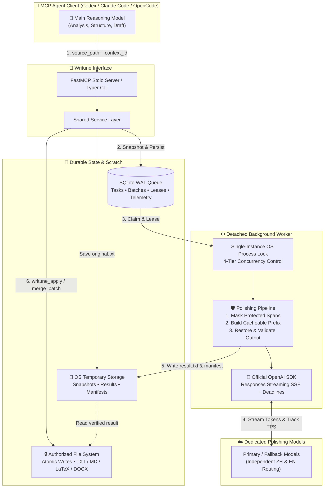

<div align="center">

<!-- Animated SVG Header Banner -->


<!-- Dynamic Typing Effect -->
<p align="center">
  
</p>

<!-- Tech & Status Badges -->
<p align="center">
  <a href="https://www.python.org/"></a>
  <a href="https://modelcontextprotocol.io/"></a>
  <a href="https://platform.openai.com/docs/api-reference/responses"></a>
  <a href="https://www.sqlite.org/"></a>
  <a href="LICENSE"></a>
</p>

<p align="center">
  
  
  
  
</p>

<!-- Navigation Bar -->
<h4>
  <a href="README.zh-CN.md">🇨🇳 简体中文</a> &nbsp;·&nbsp;
  <a href="INSTALL_PROMPT.md">⚡ One-Step Harness Install</a> &nbsp;·&nbsp;
  <a href="docs/configuration.md">⚙️ Configuration</a> &nbsp;·&nbsp;
  <a href="docs/mcp-integration.md">🔌 MCP Integration</a> &nbsp;·&nbsp;
  <a href="docs/acceptance.md">✅ Verification Guide</a>
</h4>

---

</div>

> [!IMPORTANT]
> **Writune** gives **Codex**, **Claude Code**, **OpenCode**, and other MCP agents a dedicated asynchronous polishing workflow. Choose models independently for reasoning and prose: your main model develops the content, a separately configured model refines the language, and Writune inserts the result through deterministic file operations. Long passages move from file to file without another full-text generation by the main model.

---

## ✨ Why Writune?

Choose a reasoning model for the work and a polishing model for the prose. Writune connects them through a file-based workflow: the main agent develops the content, a dedicated model refines the language, and deterministic file operations insert the result into your document.

### 🧠 Choose models for content and expression

Keep your main model's reasoning, structure, and conclusions while choosing a polishing model for the target language and genre. Chinese and English each support independently configured primary and fallback models. Shared writing context carries the topic, section, terminology, and editorial goal across related passages.

### 💸 Avoid repeated main-model output

The workflow follows `source_path → async queue → result_path → deterministic apply`. The main agent coordinates through task IDs and file paths; polished passages move directly between files without being generated again by the main model. This is especially useful for long documents and batches of paragraphs.

### 🛡️ Protect technical details during revision

Writune masks numerical fragments, statistical symbols, citations, LaTeX formulas, code blocks, and custom terminology before inference. It then restores protected spans and validates the output. Placeholder-based insertion, digest checks, and atomic writes handle document updates.

### ⚡ Keep document work moving

A SQLite WAL queue and a detached background worker persist tasks across restarts. Global, provider, model, and batch concurrency limits coordinate execution while the main agent continues independent work. If upstream attempts time out or exhaust their retry budget, `outcome="original_fallback"` delivers the preserved source text for subsequent merging and insertion.

### 📊 Workflow at a Glance

| Step | Main Agent | Writune |
| :--- | :--- | :--- |
| **Draft** | Develop reasoning, structure, and content | Reuse writing context for related passages |
| **Submit** | Pass a source path and polishing settings | Snapshot the source, queue the task, and return a task ID |
| **Polish** | Continue independent work | Route to the configured language model, restore protected spans, and validate output |
| **Apply** | Choose the destination and insertion point | Export, merge, or insert the result through deterministic file operations |

---

## 🎯 Use Cases & Genre Matrix

| Scenario | Scene Key | What Writune Delivers |
| :--- | :---: | :--- |
| 🔬 **SCI Manuscripts & Papers** | `sci_paper` | Section-aware rules (`Abstract`, `Results`, `Discussion`, `Methods`), strict distinction between association and causation, protected stats/citations |
| 🇨🇳 **Chinese Journal Articles** | `chinese_journal` | Disciplined scholarly Chinese, consistent terminology, removal of padded verb phrases (e.g., *进行讨论 → 讨论*) and formulaic transitions |
| 🛠️ **Research & Tech Docs** | `technical_report` | Unambiguous presentation of system behavior, parameters, units, versions, and observed facts vs. recommendations |
| 📖 **User Manuals & Guides** | `user_manual` | Concise, actionable step-by-step instructions preserving exact order, conditions, and warnings |
| 💼 **Business Reports** | `business_report` | Direct professional tone, clear links between findings and implications, preserved caveats |
| 🎓 **Academic Assignments & Essays** | `academic_assignment` / `school_essay` | Improved grammar and logical flow while preserving the student's reasoning, level, and personal voice |
| 📚 **Long Documents & Multi-Paragraph Batches** | *All Scenes* | Automatic Markdown segmentation, shared `context_id`, per-batch concurrency limits, and source-order merging with preserved BOM & line endings |

<details>
<summary>🎨 <b>View All 6 Built-in Polishing Styles (Click to expand)</b></summary>
<br>

| Style Key | Editorial Focus |
| :--- | :--- |
| `natural` | Fluent, idiomatic wording and varied sentence rhythm without altering meaning *(Default)* |
| `concise` | Strips unnecessary words and repetition while retaining every substantive detail |
| `formal` | Maintains a consistently formal register and eliminates colloquial phrasing |
| `academic` | Precise, measured scholarly phrasing that preserves appropriate uncertainty |
| `explanatory` | Makes relationships and referents easy to follow without inventing new facts |
| `literary` | Enhances cadence and imagery where already present while respecting the author's voice |

> 💡 *Need custom house rules?* Override any built-in scene/style or define new ones via `custom_templates` in `config.json`.

</details>

---

## 🏗️ Architecture & Workflow



<details>
<summary>📟 <b>Prefer ASCII Diagram? (Click to expand)</b></summary>

```text
Codex / Claude Code: reasoning, content, draft
                  │ source path + writing context
                  ▼
          Writune MCP / CLI
                  │
             Shared Service
          ┌───────┴────────┐
          ▼                ▼
     SQLite queue     Authorized file operations
          │                ▲
     Detached worker       │
          │                │
     Responses API ──► Results in OS temporary storage
          │
     Dedicated polishing model
```

</details>

Submission snapshots the source file and persists the task before immediately returning its `task_id` and queue-aware ETA. The background worker performs inference asynchronously. Your agent can continue independent work and apply the result when the document needs it.

---

## 🚀 Installation & Quick Start

### ⚡ Option 1: Let Your Coding Harness Install It (Recommended)

Hand **[INSTALL_PROMPT.md](INSTALL_PROMPT.md)** to a coding agent with terminal and file access (such as Claude Code, Codex, or OpenCode) and ask it to execute the installation task:

> *"Please execute `INSTALL_PROMPT.md` to complete Writune's isolated installation, configuration, MCP & Skill registration, and end-to-end verification."*

> [!TIP]
> **Dedicated installation environment:**
> Packages are installed into a `.writune-venv` marked with Writune ownership. The installation uses this dedicated environment and preserves existing Python installations, Conda environments, project virtualenvs, user `site-packages`, system `PATH`, shell profiles, and Windows registry entries. If Python is missing, the installer can provision a private `uv`-managed Python runtime inside Writune.

---

### 🛠️ Option 2: Manual Installation

Obtain the source, enter the Writune directory, and use **Python 3.11+**.

#### 1️⃣ Create the Isolated Environment

**Windows PowerShell:**

```powershell
.\scripts\install.ps1
# Or include development & test dependencies:
.\scripts\install.ps1 -WithDev
```

**macOS / Linux:**

```bash
bash scripts/install.sh
# Or include development & test dependencies:
bash scripts/install.sh --dev
```

> *Custom paths & `uv` support:* Use `-VenvPath` / `-PythonExecutable` in PowerShell or `--venv` / `--python` in Bash. Add `-UseUv` or `--uv` when `uv` is available to use Writune's private managed Python.

#### 2️⃣ Configure Provider, Models & Authorized Workspaces

**Windows PowerShell:**

```powershell
$writuneConfig = Join-Path $env:USERPROFILE '.config\writune'
.\.writune-venv\Scripts\python.exe -m writune init --home $writuneConfig
.\.writune-venv\Scripts\python.exe -m writune doctor --home $writuneConfig
```

**macOS / Linux:**

```bash
writune_config="$HOME/.config/writune"
.writune-venv/bin/python -m writune init --home "$writune_config"
.writune-venv/bin/python -m writune doctor --home "$writune_config"
```

Interactive setup configures:
- **Upstream Responses API** address, port, and hidden API Key (stored separately in `.env`, never in `config.json`)
- **Language-Specific Models** (`provider/model` format) for Chinese & English primary and fallback slots
- **Authorized Workspaces**, default style, concurrency limits, timeouts, minimum TPS, retries, and temp file TTL
- For scripted setup, use `init --non-interactive --config-file <path>`.

#### 3️⃣ Register MCP & Companion Skill Automatically

The registration script merges the Writune entry while preserving unrelated client settings, keeping Codex TOML comments intact, and saving a pre-edit backup in OS temporary storage.

**Windows PowerShell (Codex):**

```powershell
.\.writune-venv\Scripts\python.exe scripts/register_mcp.py --client codex --executable "$PWD/.writune-venv/Scripts/writune.exe" --home $writuneConfig --install-skill
```

**macOS / Linux (Codex):**

```bash
.writune-venv/bin/python scripts/register_mcp.py --client codex --executable "$PWD/.writune-venv/bin/writune" --home "$writune_config" --install-skill
```

- For **Claude Code**, change `--client codex` to `--client claude-code`.
- If a different Writune entry already exists, inspect its path and pass `--replace` to update it, or `--config` for a custom config path.
- On Windows, registration automatically binds `pythonw.exe` so both the MCP server and background worker run **completely windowless** without flashing a console.

| Client | User MCP Configuration | User Skill Location |
| :--- | :--- | :--- |
| **Codex** | `~/.codex/config.toml` (honors `CODEX_HOME`) | `~/.agents/skills/writune-polish` |
| **Claude Code** | `mcpServers.writune` in `~/.claude.json` | `~/.claude/skills/writune-polish` |
| **OpenCode** | `mcp.servers.writune` in `opencode.json` / `opencode.jsonc` | `.agents/skills/writune-polish` |

See **[MCP Integration](docs/mcp-integration.md)** for manual configuration snippets and OpenCode details.

---

## 💻 Usage & Workflows

### 📝 1. Polish a Paragraph and Insert It into a Document

Save your draft inside an authorized workspace. First, create a reusable document context with `writune_create_context` (defining topic, section, terminology list, and writing goal), then submit the paragraph via `writune_submit`:

```json
{
  "source_path": "/absolute/allowed/workspace/draft.txt",
  "language": "en",
  "scene": "sci_paper",
  "style": "academic",
  "context_id": "ctx_<returned-id>"
}
```

Check progress with `writune_status(task_id=...)`. Once the task completes, `writune_result` returns compact metadata (`outcome`, `result_path`, `manifest_path`). Set `inline_text=true` to retrieve the text itself.

Place a unique placeholder marker `{{WRITUNE:RESULTS}}` in your target manuscript and call `writune_apply`:

```json
{
  "task_id": "<returned-task-id>",
  "target_path": "/absolute/allowed/workspace/manuscript.md",
  "placeholder_id": "RESULTS"
}
```

> [!NOTE]
> **Safe Preview vs. In-Place Publication:**
> By default, `writune_apply` writes the applied copy to OS temporary storage so your working tree stays clean. Pass `output_path` when ready for final delivery, or set `output_path` to `target_path` with `overwrite=true` for an atomic in-place edit. Supported formats: **TXT, Markdown, LaTeX, and DOCX** (in DOCX, the marker must occupy its own text paragraph).

---

### 📚 2. Batch Polish a Markdown Document & Merge in Source Order

Submit an entire Markdown file for automatic paragraph segmentation with a per-batch concurrency cap:

```json
{
  "markdown_path": "/absolute/allowed/workspace/draft.md",
  "language": "zh",
  "scene": "technical_report",
  "style": "natural",
  "max_concurrency": 2
}
```

Pass these arguments to `writune_submit_batch` and query progress using `batch_id`. When complete, call `writune_merge_batch(batch_id=..., output_path=...)`. Automatic Markdown segmentation preserves **exact source order, paragraph separators, UTF BOM, and CRLF/LF line endings**.

---

### 🧰 Complete MCP Toolset Reference

| MCP Tool | Purpose | Key Highlights |
| :--- | :--- | :--- |
| `writune_create_context` | Create or update a content-addressed writing context | SHA-256 deduplicated `context_id`; protects custom `terminology` spans |
| `writune_submit` | Queue a single paragraph from text or `source_path` | Returns `task_id`, queue position, and historical/queue-aware ETA immediately |
| `writune_submit_batch` | Queue item lists, multiple files, or a Markdown document | Supports durable per-batch `max_concurrency` and idempotency keys |
| `writune_status` | Query progress for a `task_id` or `batch_id` | Reports progress ratio, running/completed counts, dynamic ETA, and error codes |
| `writune_result` | Retrieve task outcome and file paths | `outcome` is `polished` or `original_fallback`; `inline_text=true` is opt-in |
| `writune_apply` | Insert polished result at `{{WRITUNE:ID}}` placeholder | Atomic write, digest verification, supports TXT / MD / LaTeX / DOCX |
| `writune_export` | Copy a completed result to an authorized workspace path | Clean file handoff without reading text into the agent |
| `writune_merge_batch` | Merge completed batch items in original order | Retains original Markdown separators, encoding, BOM, and newline style |
| `writune_cancel` | Cancel a queued or running task | Gracefully halts queued tasks or flags active worker streams |
| `writune_health` | Inspect service, worker, queue, storage, and providers | Set `probe=true` to run a live upstream connectivity check |

---

## 🗄️ Storage Architecture & Maintenance

Writune stores configuration, credentials, queue metadata, and temporary task files separately. Final documents go to the explicit output paths you choose:

| Artifact Type | Storage Location | Lifecycle & Security |
| :--- | :--- | :--- |
| **Provider Settings** | `config.json` in Writune config dir (`WRITUNE_HOME`) | Non-secret settings only; redacted in CLI output |
| **API Credentials** | `.env` in Writune config dir (`WRITUNE_HOME`) | Stored privately; never written to `config.json` or client MCP configs |
| **Queue & Telemetry** | SQLite database in `data_dir` | Durable WAL mode; retains bounded performance & cache metrics |
| **Snapshots & Results** | `Settings.task_dir` under OS `tempfile.gettempdir()` | Isolated by user, database, and `task_id` (`0700` permissions) |
| **Default Apply Copies** | Writune OS temporary storage | Keeps manuscript directories free of generated siblings |
| **Final Deliverables** | Caller's explicit `output_path` | Must reside inside an authorized `allowed_workspaces` root |

> If the OS cleans up old temporary files or `task_ttl_hours` expires, querying expired artifacts returns `TASK_FILES_EXPIRED`—simply resubmit the source file to create a fresh task.

### 🔧 CLI Maintenance Commands

```bash
# Inspect redacted settings or update a specific configuration key
writune config show
writune config set default_style natural

# Run local health diagnostics (or add --probe for a live API request)
writune doctor
writune doctor --probe

# Inspect rolling 50-sample model TPS, latency, cache hits, and configured cost
writune stats

# Clean expired task files, or clear all terminal history while keeping active tasks
writune cleanup
writune cleanup --all
```

*(Append `--home <path>` when using a custom configuration directory.)*

---

## 🛠️ Development & Architecture Internals

### 📂 Repository Structure

```text
src/writune/
├── cli.py                 # Typer CLI & interactive/non-interactive initialization
├── mcp_server.py          # FastMCP stdio server & tool definitions
├── config.py              # Pydantic settings, secret isolation, model overrides
├── service.py             # Shared business layer for MCP, CLI, and Worker
├── tasks/                 # SQLite WAL queue, worker leases, crash recovery, dynamic ETA
├── providers/             # Official OpenAI SDK Responses SSE streaming & TPS tracking
├── polishing/             # Scenes, styles, Sepia editorial workflow, span protection & validation
├── files/                 # Workspace authorization, atomic publication, encoding & DOCX handler
└── telemetry/             # Rolling window performance, cache usage & price accounting
scripts/                   # Isolated installation (.ps1/.sh), MCP/Skill registration, wheel verification
tests/                     # Unit, cross-process, crash-recovery, and real stdio integration tests
.agents/skills/            # Companion writune-polish Agent Skill & editorial references
docs/                      # Configuration, architecture, MCP integration, and acceptance guides
INSTALL_PROMPT.md          # End-to-end executable installation prompt for coding harnesses
```

### ⚙️ Runtime Highlights & Extension Points

- **4-Tier Concurrency & Lease Recovery:** SQLite WAL transactions coordinate task claims, priorities, idempotency keys, and worker leases. A saturated batch, model, or provider never blocks unrelated tasks in the global queue.
- **Strict Deadline & TPS Governance:** Built on the official OpenAI Python SDK's streaming `Responses` API, Writune enforces independent connection, first-token, inactivity, and total timeouts alongside warm-up `min_tps` slow-generation detection.
- **Extensibility:**
  - Add or customize scenes and styles in [`src/writune/polishing/prompt.py`](src/writune/polishing/prompt.py).
  - Extend upstream protocol adapters in [`src/writune/providers/registry.py`](src/writune/providers/registry.py).
  - Add document format handlers in [`src/writune/files/`](src/writune/files/).
  - Integrate future MCP protocol extensions via [`TaskExtensionAdapter`](src/writune/tasks/protocol.py).

### 🧪 Testing & Packaging

Using the dedicated environment with development dependencies installed:

```powershell
# Run the full test suite (Mock Responses, SSE, timeouts, crash recovery, DOCX, real MCP stdio)
.\.writune-venv\Scripts\python.exe -m pytest -q

# Build source distribution and wheel
.\.writune-venv\Scripts\python.exe -m build

# Verify isolated wheel installation, CLI entry point, and bundled skill files
.\.writune-venv\Scripts\python.exe scripts/verify_package.py
```

*(On macOS or Linux, replace `.\.writune-venv\Scripts\python.exe` with `.writune-venv/bin/python`. See the [Verification Guide](docs/acceptance.md) for repeatable acceptance checks.)*

---

## 🙏 Acknowledgments

Writune's polishing prompts and companion skill draw on **[Nanako0129/sepia](https://github.com/Nanako0129/sepia)** by **Nanako Tsai** (MIT License): genre calibration, diagnosis before revision, selective editing, sentence rhythm, and checks for added filler and over-editing.

These principles guide Writune's language revisions while preserving source meaning. See the **[Adaptation & Source References](.agents/skills/writune-polish/references/sepia-method.md)** and **[Upstream Copyright & License Notice](.agents/skills/writune-polish/references/sepia-license.md)**.

---

## 📄 License

Released under the **[MIT License](LICENSE)**.

<div align="center">
  
</div>
