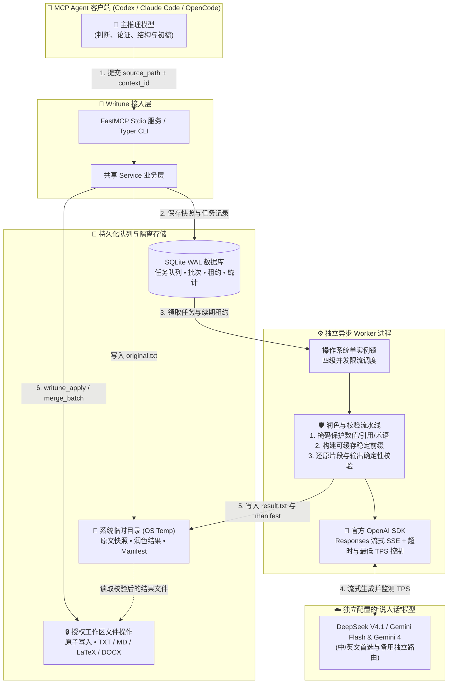

<div align="center">

<!-- 顶部动态渐变波浪横幅 -->


<!-- 动态打字机副标题 -->
<p align="center">
  
</p>

<!-- 核心技术与协议徽章 -->
<p align="center">
  <a href="https://www.python.org/"></a>
  <a href="https://modelcontextprotocol.io/"></a>
  <a href="https://platform.openai.com/docs/api-reference/responses"></a>
  <a href="https://www.sqlite.org/"></a>
  <a href="LICENSE"></a>
</p>

<p align="center">
  
  
  
  
</p>

<!-- 快速导航栏 -->
<h4>
  <a href="README.en.md">🇺🇸 English</a> &nbsp;·&nbsp;
  <a href="INSTALL_PROMPT.md">⚡ 一键安装 Prompt</a> &nbsp;·&nbsp;
  <a href="MANUAL_INSTALL.zh-CN.md">🛠️ 手动安装指南</a> &nbsp;·&nbsp;
  <a href="docs/configuration.md">⚙️ 配置说明</a> &nbsp;·&nbsp;
  <a href="docs/mcp-integration.md">🔌 MCP 集成</a>
</h4>

---

</div>

> [!IMPORTANT]
> **ChatGPT 等高智能推理模型的逻辑能力很强，但语言表达往往生硬，充满“AI 翻译腔”和防御性废话。**
> **Writune** 让你能把低成本、擅长“说人话”的模型（如 **DeepSeek V4.1**、**Gemini Flash / Gemini 4 系列**等）直接无缝嵌入 **Codex**、**Claude Code**、**OpenCode** 的写作流程中——**无需手动来回复制粘贴润色**，也无需让昂贵的主模型把长篇正文重新输出一遍。

---

## ✨ 项目特色：为什么选择 Writune？

### 🧠 1. 高智力推理 + 低成本“说人话”模型无缝组合

ChatGPT 与 Claude 擅长复杂推理、代码分析与研究设计，但写出的论文、报告或中文文档常常句式僵硬、套话连篇。写完后若再到其他网页手动复制粘贴来润色，不仅繁琐，还容易破坏格式与引用。

**Writune 将内容推理与语言表达彻底解耦：**
- **主模型专注思考：** 由高智力主模型负责实验分析、论证结构搭建与初稿起草。
- **“说人话”模型专注措辞：** 自动调用单独配置的低成本、高自然度语言模型（强烈推荐使用 **DeepSeek V4.1**、**Gemini Flash / Gemini 4 系列** 等，中英文可分别指定首选与备用模型）完成地道的语言打磨。
- **全流程零复制粘贴：** 通过底层文件交接自动完成提交、润色与回写。

### 💸 2. 节省主模型重复输出正文的 Token

采用 `文件路径提交 → 异步队列 → 结果文件 → 确定性写入` 流程。主模型只需通过极短的任务 ID 与文件路径来协调流程，润色后的长篇正文直接在文件之间交接写入，省去主模型重复生成整篇文档所需的高昂输出 Token。

### 🛡️ 3. 严谨保护学术细节 & 后台异步不阻塞

- **事实与数据零篡改：** 推理前自动掩码保护**数值、统计符号、引用标记、LaTeX 公式、代码块与自定义术语（如基因/蛋白名）**，生成后精确还原并做确定性校验。
- **持久化队列与原文兜底：** 基于 SQLite WAL 队列与后台独立 Worker，支持四级并发限流。若上游超时或重试耗尽，`outcome="original_fallback"` 会自动交付保留的原文，确保文档拼装永不中断。

### 📊 工作流一览

| 步骤 | 主模型 / Agent（高智力推理） | Writune（“说人话”润色） |
| :--- | :--- | :--- |
| **1. 起草** | 完成逻辑判断、论证结构与内容初稿 | 为同一章节的相关段落复用写作上下文（`context_id`） |
| **2. 提交** | 传入原文文件路径及场景/风格参数 | 保存原文快照、加入异步队列，并立即返回 `task_id` |
| **3. 润色** | 不阻塞，继续推进其他独立任务 | 调用 DeepSeek V4.1 / Gemini 等模型，还原保护片段并校验 |
| **4. 写入** | 指定目标文档位置与占位符 | 通过原子文件操作直接导出、按序合并或精确插入成稿 |

---

## 🎯 适用场景与文体矩阵

| 应用场景 | 场景标识 (`scene`) | Writune 提供的针对性能力 |
| :--- | :---: | :--- |
| 🔬 **SCI 论文与英文手稿** | `sci_paper` | 支持按章节（`Abstract`、`Results`、`Discussion`、`Methods`）微调规范，严格区分相关性与因果推断，保护数值、统计符号与引用 |
| 🇨🇳 **中文核心与学术期刊** | `chinese_journal` | 严谨自然的学术中文，统一术语，精简冗余动词结构（如 *“进行讨论” → “讨论”*），剔除模板化的空洞过渡与套话 |
| 🛠️ **研究报告与技术文档** | `technical_report` | 消除歧义，准确呈现系统行为、参数、单位、版本号，严格区分“已观测事实”与“建议措施” |
| 📖 **用户手册与操作指南** | `user_manual` | 简明可执行的步骤说明，严格保留操作顺序、前置条件、警告提示与技术细节 |
| 💼 **商业分析与商务报告** | `business_report` | 专业直接的商务语体，清晰呈现发现与推论之间的逻辑关系，完整保留限定条件 |
| 🎓 **课程论文与学术作业** | `academic_assignment` / `school_essay` | 改善语法与衔接逻辑，同时保留作者原本的论点深度、学术水平与个人语感，不凭空捏造论据 |
| 📚 **多段长文档批量工作流** | *全部场景适用* | Markdown 自动分段、复用 `context_id` 背景、按批次独立设置并发上限，并按原始顺序合并（完整保留 BOM、换行符与段落分隔） |

<details>
<summary>🎨 <b>查看内置的 6 种润色风格（点击展开）</b></summary>
<br>

| 风格标识 (`style`) | 润色侧重点 |
| :--- | :--- |
| `natural` | 流畅地道的表达与富于变化的句式节奏，不改变原意 *（默认）* |
| `concise` | 删减冗余词句与重复结构，同时保留每一处实质性细节 |
| `formal` | 保持一致的正式语体，消除口语化表达 |
| `academic` | 精确、克制的学术措辞，保留恰当的不确定性限定与审慎语气 |
| `explanatory` | 理顺指代关系与句子衔接，使逻辑易于理解，但不凭空添加解释或背景事实 |
| `literary` | 在原文基础上优化韵律与意象，尊重作者原有的声音与情感 |

> 💡 **支持自定义模板：** 可在 `config.json` 的 `custom_templates` 中覆盖内置场景/风格，或新增团队专属的文体规范。

</details>

---

## 🚀 安装与快速上手

提供三种安装方式。自动 Prompt 和 PyPI 安装共用包内 CLI；全手动安装则逐项创建配置文件和 MCP 条目。

| 方式 | 适合谁 | 入口 |
| --- | --- | --- |
| 自动 Prompt | 让编码助手完成安装、配置和验收 | [INSTALL_PROMPT.md](INSTALL_PROMPT.md) |
| PyPI / pip | 自己运行命令，由 CLI 完成配置 | 下方命令 |
| 全手动 | 自己创建环境、填写 JSON/.env、编辑 MCP 配置并复制 Skill | [全手动指南](MANUAL_INSTALL.zh-CN.md) |

### 自动 Prompt

把 [INSTALL_PROMPT.md](INSTALL_PROMPT.md) 交给 Codex、Claude Code 或 OpenCode，并发送：

> 请按这份 Prompt 从 PyPI 安装 Writune，完成配置、MCP 注册、Skill 安装和验收。

助手将新建专用 Python 环境，从 PyPI 安装软件包，然后执行与下文相同的 CLI 流程，无需克隆仓库，也无需下载项目安装脚本。

### PyPI：安装后统一使用 CLI

需要 **Python 3.11+**。在新建并激活的专用虚拟环境中执行：

```sh
pip install --upgrade "writune>=0.1.2"
writune init
writune mcp register --client codex --install-skill
writune doctor
```

`writune init` 会询问 Responses API 地址、隐藏输入的 API Key、中英文首选/备用模型、授权工作区和运行参数。凭据单独保存在配置目录的 `.env` 中。`--client` 可选 `codex`、`claude-code` 或 `opencode`；多个客户端分别注册。Windows 下自动使用当前环境的 `pythonw.exe`，后台运行时不弹出窗口。

环境创建示例：Windows 先使用 `python -m venv .writune-venv`，再运行 `.\.writune-venv\Scripts\Activate.ps1`；macOS/Linux 先使用 `python3 -m venv .writune-venv`，再运行 `source .writune-venv/bin/activate`。若不激活环境，可直接使用该环境的绝对 Python 路径执行 `-m writune`，完整示例见[全手动指南](MANUAL_INSTALL.zh-CN.md)。已有目录应保留，另选新环境路径。

初始化、MCP 注册和诊断命令可使用同一个 `--home <目录>` 固定配置位置；注册后的 MCP 也会使用该目录。后续调整可用：

```sh
writune config show
writune config set max_concurrency 4
writune config set providers.primary.api_key
writune mcp show --client codex
writune skill install --client codex
writune test-provider
```

`config show` 隐藏密钥；不带值的密钥设置会隐藏输入。`test-provider` 会发起真实的短模型请求。完成注册后，重新连接客户端的 Writune MCP。

更改运行配置后，请在当前任务结束、空闲 worker 退出后重连 MCP，以便新进程加载配置。CLI 的新调用会直接读取已保存的设置。

### 全手动与版本更新

[全手动指南](MANUAL_INSTALL.zh-CN.md) 不调用项目安装脚本，也不调用 `init` 或 `mcp register` 来代填配置：你将直接创建 `config.json`、`.env` 和客户端 MCP 条目，并复制包内附带的完整 Skill。

自动更新会通过 HTTPS 检查 PyPI 上已发布的稳定版本，校验 wheel 的 SHA-256，并在当前任务结束后复用原目录更新。若存在本地改动，或依赖、Python 要求、入口发生变化，则保留现状；需要完整升级时，在同一环境运行 `pip install --upgrade writune`。可通过 `writune update-status` 查看结果，或通过 `writune config set auto_update false` 关闭自动更新。详见[配置说明](docs/configuration.md)。

---

### 💬 2. 极简使用：一句话触发润色

安装完成后，**无需记忆任何工具名称，也无需手动编写参数**。日常写作时，只需在对话提示词中加入 **“使用Writune润色”**，即可自动触发全流程：

```text
请根据实验数据起草论文的 Results 与 Discussion 章节，并使用Writune润色最终生成的文档。
```

Agent 会自动完成逻辑起草 → 提交文件给 Writune 后台润色 → 将打磨好的自然文本直接写入你的目标文档！

---

### 🔥 3. 黄金搭档：强烈推荐搭配使用的 Skills

将 Writune 与以下两个写作 Skill 组合使用，可最大程度避免ChatGPT等模型混乱的输出以及毫无意义的防御性写作：

| 推荐搭配 Skill | 核心作用 | 与 Writune 的协同效果 |
| :--- | :--- | :--- |
| 🏛️ **[nature-writing](https://github.com/Yuan1z0825/nature-skills/tree/main/skills/nature-writing)** | **生成高质量学术写作文档** | 在起草阶段指导主模型搭建严密的科学论证结构、章节逻辑与顶刊级初稿，再交由 Writune 完成精细语言打磨。 |
| ✂️ **[jung233/anti-defensive-writing-Skill](https://github.com/jung233/anti-defensive-writing-Skill)** | **防止 AI 生成防御性废话** | 强力剔除大模型常见的免责声明、车轱辘话、过度铺垫与防御性废话，让文风干净利落、直击重点。 |

最佳搭配：
```text
请根据实验数据，依据nature-writing和anti-defensive-writing-Skill起草论文的 Results 与 Discussion 章节，并使用Writune润色最终生成的文档。
```
---

## 🏗️ 系统架构与工作流



<details>
<summary>📟 <b>查看纯文本 ASCII 架构图（点击展开）</b></summary>

```text
Codex / Claude Code：推理、内容与初稿
                  │ 文件路径 + 写作上下文
                  ▼
          Writune MCP / CLI
                  │
             共享 Service
          ┌───────┴────────┐
          ▼                ▼
     SQLite 队列      文件授权与写入
          │                ▲
     独立异步 Worker        │
          │                │
     Responses API ──► 系统临时目录中的结果
          │
     独立配置的润色模型
```

</details>

---

## 💻 进阶使用与底层工具调用

当你说出 **“使用Writune润色”** 时，Agent 会在底层自动编排以下 MCP 工具（你也可以在脚本或 CLI 中直接调用）：

### 📝 1. 单段润色并精确写入目标文档

1. **创建上下文：** 调用 `writune_create_context` 设置主题、章节、术语表（如基因名、专有名词）和写作目标，并获取可复用的 `context_id`。
2. **提交文件：** 调用 `writune_submit` 异步入队：
   ```json
   {
     "source_path": "/absolute/allowed/workspace/draft.txt",
     "language": "en",
     "scene": "sci_paper",
     "style": "academic",
     "context_id": "ctx_<returned-id>"
   }
   ```
3. **占位符写入：** 在目标文档中放置唯一标记 `{{WRITUNE:RESULTS}}`，调用 `writune_apply`：
   ```json
   {
     "task_id": "<returned-task-id>",
     "target_path": "/absolute/allowed/workspace/manuscript.md",
     "placeholder_id": "RESULTS"
   }
   ```
   *（默认将预览副本保存到系统临时目录；传入 `output_path` 与 `overwrite=true` 即可原地原子覆盖写入，支持 **TXT、Markdown、LaTeX 与 DOCX**。）*

### 📚 2. Markdown 批量润色与按序合并

直接提交整篇 Markdown 初稿，即可自动切分段落，并按批次并发上限执行：

```json
{
  "markdown_path": "/absolute/allowed/workspace/draft.md",
  "language": "zh",
  "scene": "technical_report",
  "style": "natural",
  "max_concurrency": 2
}
```

传入 `writune_submit_batch`，完成后调用 `writune_merge_batch(batch_id=..., output_path=...)` 即可按原始顺序合并，并完整保留**空行分隔、UTF BOM 头以及 CRLF/LF 换行格式**。

<details>
<summary>🧰 <b>展开查看全部 10 个 MCP 工具速查表</b></summary>
<br>

| MCP 工具名称 | 核心功能 | 关键特性说明 |
| :--- | :--- | :--- |
| `writune_create_context` | 创建或更新内容寻址的写作上下文 | 基于 SHA-256 生成稳定 `context_id`；支持 `terminology` 术语掩码保护 |
| `writune_submit` | 提交单段文本或授权文件路径 | 立即返回 `task_id`、队列位置与动态 ETA，不阻塞调用方 |
| `writune_submit_batch` | 批量提交段落列表、多文件或 Markdown 文档 | 支持持久化批次并发上限 `max_concurrency` 与批次幂等键 |
| `writune_status` | 查询单任务或批次的实时进度 | 返回完成比例、运行/完成数、动态剩余秒数与精简错误码 |
| `writune_result` | 获取任务结果状态与文件路径 | `outcome` 区分 `polished` 与 `original_fallback`；默认不回传长正文 |
| `writune_apply` | 将结果插入目标文档的 `{{WRITUNE:ID}}` 处 | 原子写入 + 摘要校验；支持 TXT / MD / LaTeX / DOCX 及传统 `gbk` 编码 |
| `writune_export` | 将已完成的结果复制到授权交付路径 | 实现纯文件级交付，无需主模型经手正文内容 |
| `writune_merge_batch` | 按原始段落顺序合并批次结果 | 自动还原 Markdown 分隔符、编码、BOM 与换行风格 |
| `writune_cancel` | 取消排队中或运行中的任务 | 排队任务立即终止，运行中任务向 Worker 发送中断信号 |
| `writune_health` | 检查配置、凭据、Worker、队列与存储状态 | 显式传入 `probe=true` 时可向已配置的 Provider 发起真实连通性探测 |

</details>

---

## 🗄️ 文件存放与日常运维

Writune 将配置、凭据、队列数据库与任务临时文件分开存放，不会在你的原稿目录旁产生冗余副本：

| 内容类别 | 存放位置 | 生命周期与安全策略 |
| :--- | :--- | :--- |
| **Provider 设置与密钥** | 独立配置目录（`WRITUNE_HOME`）下的 `config.json` 与 `.env` | API Key 独立且私密地存放于 `.env`，绝不写入 `config.json` 或客户端配置 |
| **队列、状态与统计** | `data_dir` 中的 SQLite 数据库 | 使用 WAL 事务模式；记录 最近 50 次采样窗口 的性能、缓存与费用统计 |
| **原文快照、结果与预览副本** | 系统临时目录（`Settings.task_dir`）下的隔离子目录 | 目录权限为 `0700`；支持按 `task_ttl_hours` 自动清理过期终态任务 |
| **最终交付成稿** | 调用方显式传入的 `output_path` | 必须位于 `allowed_workspaces` 授权目录范围内 |

```bash
# 常用 CLI 运维命令（使用自定义配置目录时追加 --home <path>）
writune config show
writune config set default_style natural
writune doctor --probe
writune stats
writune cleanup --all
```

---

## 🛠️ 开发与架构扩展

<details>
<summary>📂 <b>查看代码仓库结构、扩展点与测试打包命令（点击展开）</b></summary>
<br>

### 代码仓库结构

```text
src/writune/
├── integration.py         # Package-native MCP registration and bundled skill installation
├── cli.py                 # Typer CLI 命令与交互式/非交互式初始化
├── mcp_server.py          # FastMCP stdio 服务端与 MCP 工具协议适配
├── config.py              # 配置模型、凭据隔离、路径解析与逐模型参数覆盖
├── service.py             # MCP、CLI 与 Worker 共用的核心业务层
├── tasks/                 # SQLite WAL 队列、Worker 进程、租约续期、崩溃恢复与动态 ETA
├── providers/             # 官方 OpenAI SDK Responses 流式适配与实时 TPS 计算
├── polishing/             # 场景与风格模板、Sepia 编辑工作流、保护片段掩码与输出校验
├── files/                 # 临时存储、工作区路径授权、原子写入、编码保留与 DOCX 处理
└── telemetry/             # 滚动窗口性能观测、缓存 Token 统计与显式配置价格核算
scripts/                   # 开发验收、更新清单生成与安装包校验
tests/                     # 单元、跨进程、崩溃恢复、超时回退与真实 stdio 端到端测试
.agents/skills/            # writune-polish Agent 写作工作流 Skill 与编辑方法参考文档
docs/                      # 配置详解、系统架构、MCP 接入与验收标准文档
```

### 模块化扩展入口

- 新增或调整场景与风格：扩展 [`src/writune/polishing/prompt.py`](src/writune/polishing/prompt.py)
- 接入新的 Provider 协议适配：从 [`src/writune/providers/registry.py`](src/writune/providers/registry.py) 开始
- 扩展文档格式支持：集中在 [`src/writune/files/`](src/writune/files/)
- 接入未来的 MCP 原生异步任务扩展：通过 [`TaskExtensionAdapter`](src/writune/tasks/protocol.py) 注入

### 测试与打包校验

```powershell
.\.writune-venv\Scripts\python.exe -m pytest -q
.\.writune-venv\Scripts\python.exe scripts/build_update_manifest.py
.\.writune-venv\Scripts\python.exe -m build
.\.writune-venv\Scripts\python.exe scripts/verify_package.py
```

完整、可复现的验收步骤参见 [验证指南](docs/acceptance.md)。

</details>

---

## 🙏 致谢与开源许可

Writune 的润色提示词与配套 Skill 借鉴了 **Nanako Tsai** 的 **[Nanako0129/sepia](https://github.com/Nanako0129/sepia)** 项目（MIT 许可），涵盖体裁校准、先诊断后修订、选择性修改、句式节奏，以及冗余内容与过度改写检查，并针对事实与原意的保留作了适配。详见 **[方法提炼与来源说明](.agents/skills/writune-polish/references/sepia-method.md)** 与 **[上游版权及许可声明](.agents/skills/writune-polish/references/sepia-license.md)**。

本项目采用 **[MIT License](LICENSE)** 开源许可协议。

<div align="center">
  
</div>
