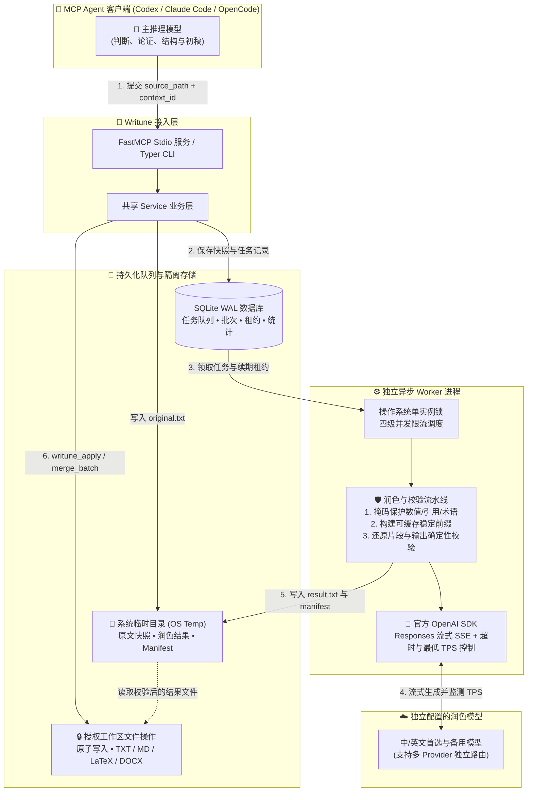

<div align="center">

<!-- 顶部动态渐变波浪横幅 -->


<!-- 动态打字机副标题 -->
<p align="center">
  
</p>

<!-- 核心技术与协议徽章 -->
<p align="center">
  <a href="https://www.python.org/"></a>
  <a href="https://modelcontextprotocol.io/"></a>
  <a href="https://platform.openai.com/docs/api-reference/responses"></a>
  <a href="https://www.sqlite.org/"></a>
  <a href="LICENSE"></a>
</p>

<p align="center">
  
  
  
  
</p>

<!-- 快速导航栏 -->
<h4>
  <a href="README.md">🇺🇸 English</a> &nbsp;·&nbsp;
  <a href="INSTALL_PROMPT.md">⚡ 一键安装 Prompt</a> &nbsp;·&nbsp;
  <a href="docs/configuration.md">⚙️ 配置说明</a> &nbsp;·&nbsp;
  <a href="docs/mcp-integration.md">🔌 MCP 集成</a> &nbsp;·&nbsp;
  <a href="docs/acceptance.md">✅ 验证指南</a>
</h4>

---

</div>

> [!IMPORTANT]
> **Writune** 为 **Codex**、**Claude Code**、**OpenCode** 等 MCP Agent 提供独立的异步润色工作流。**推理与表达分别选模型**：主模型完成判断、论证、结构与初稿，独立配置的润色模型打磨语言，Writune 再通过确定性的文件操作将结果写入目标文档。长篇正文直接在文件之间交接，节省主模型重复输出全文的 Token。

---

## ✨ 为什么选择 Writune？

按任务选择推理模型，按语言与文体选择润色模型。Writune 通过文件工作流连接两者：主模型完成内容与论证，专门配置的模型打磨表达，再由确定性的文件操作将结果写入文档。

### 🧠 分别选择内容与表达所需的模型

保留主模型形成的判断、结构与结论，按目标语言和文体配置润色模型。中文与英文均可独立设置首选和备用模型；相关段落可复用写作上下文，以统一主题、章节、术语与编辑目标。

### 💸 节省主模型重复输出正文的 Token

主模型通过 `文件路径提交 → 异步队列 → 结果文件 → 确定性写入`，以任务 ID 和文件路径协调流程，润色正文在文件之间直接交接，无需由主模型再次生成。长文档与多段批量处理都可沿用这一流程。

### 🛡️ 保护修订中的技术细节

Writune 在推理前对数值、统计符号、引用标记、LaTeX 公式、代码块与自定义术语做掩码保护，生成后还原保护片段并校验输出。文档更新通过占位符定位、内容摘要校验与原子写入完成。

### ⚡ 后台润色，持续推进文档工作

SQLite WAL 队列与独立后台 Worker 持久保存任务，支持重启恢复。全局、Provider、模型与批次四级并发上限协调任务执行，主模型可继续处理其他独立工作。上游请求超时或重试预算耗尽时，`outcome="original_fallback"` 交付保留的原文，供后续合并与写入使用。

### 📊 工作流一览

| 步骤 | 主模型 / Agent | Writune |
| :--- | :--- | :--- |
| **起草** | 完成判断、论证、结构与内容 | 为相关段落复用写作上下文 |
| **提交** | 传入原文路径与润色设置 | 保存原文快照、加入队列并返回任务 ID |
| **润色** | 继续处理其他独立工作 | 调用对应语言的模型，还原保护片段并校验结果 |
| **写入** | 指定交付位置与插入点 | 通过确定性文件操作导出、合并或插入结果 |

---

## 🎯 适用场景与文体矩阵

| 应用场景 | 场景标识 (`scene`) | Writune 提供的针对性能力 |
| :--- | :---: | :--- |
| 🔬 **SCI 论文与英文手稿** | `sci_paper` | 支持按章节（`Abstract`、`Results`、`Discussion`、`Methods`）微调规范，严格区分相关性与因果推断，保护数值、统计符号与引用 |
| 🇨🇳 **中文核心与学术期刊** | `chinese_journal` | 严谨自然的学术中文，统一术语，精简冗余动词结构（如 *“进行讨论” → “讨论”*），剔除模板化空洞过渡与套话 |
| 🛠️ **研究报告与技术文档** | `technical_report` | 消除歧义，准确呈现系统行为、参数、单位、版本号，严格区分“已观测事实”与“建议措施” |
| 📖 **用户手册与操作指南** | `user_manual` | 简明可执行的步骤说明，严格保留操作顺序、前置条件、警告提示与技术细节 |
| 💼 **商业分析与商务报告** | `business_report` | 专业直接的商务语体，清晰呈现发现与推论之间的逻辑关系，完整保留限定条件 |
| 🎓 **课程论文与学术作业** | `academic_assignment` / `school_essay` | 改善语法与衔接逻辑，同时保留作者原本的论点深度、学术水平与个人语感，不凭空捏造论据 |
| 📚 **多段长文档批量工作流** | *全部场景适用* | Markdown 自动分段、复用 `context_id` 背景、独立批次并发上限，并按原始顺序合并（完整保留 BOM、换行符与段落分隔） |

<details>
<summary>🎨 <b>查看内置的 6 种润色风格（点击展开）</b></summary>
<br>

| 风格标识 (`style`) | 润色侧重点 |
| :--- | :--- |
| `natural` | 流畅地道的表达与富于变化的句式节奏，不改变原意 *（默认）* |
| `concise` | 删减冗余词句与重复结构，同时保留每一处实质性细节 |
| `formal` | 保持一致的正式语体，消除口语化表达 |
| `academic` | 精确、克制的学术措辞，保留恰当的审慎度与不确定性限定 |
| `explanatory` | 理顺指代关系与句子衔接，使逻辑易于理解，但不凭空添加解释或背景事实 |
| `literary` | 在原文已有的基础上优化韵律与意象，尊重作者原有的声音与情感 |

> 💡 **支持自定义模板：** 可在 `config.json` 的 `custom_templates` 中覆盖内置场景/风格，或新增团队专属的文体规范。

</details>

---

## 🏗️ 系统架构与工作流



<details>
<summary>📟 <b>查看纯文本 ASCII 架构图（点击展开）</b></summary>

```text
Codex / Claude Code：推理、内容与初稿
                  │ 文件路径 + 写作上下文
                  ▼
          Writune MCP / CLI
                  │
             共享 Service
          ┌───────┴────────┐
          ▼                ▼
     SQLite 队列      文件授权与写入
          │                ▲
     独立异步 Worker        │
          │                │
     Responses API ──► 系统临时目录中的结果
          │
     独立配置的润色模型
```

</details>

提交时，Writune 会先保存原文快照与任务记录，随后立即返回 `task_id` 与基于队列压力的动态预估耗时（ETA）。Worker 在后台异步执行推理，Agent 可继续处理其他独立工作，待需要插入文本时再查询结果并写入目标文档。MCP 与 CLI 完全共用同一套 `Service` 业务层。

---

## 🚀 安装与快速上手

### ⚡ 方式一：交给编码助手自动安装（推荐）

把 **[INSTALL_PROMPT.md](INSTALL_PROMPT.md)** 交给具有终端与文件编辑能力的编码助手（如 Claude Code、Codex 或 OpenCode），并发送指令：

> *“请执行这份安装 Prompt，完成 Writune 的独立安装、配置、MCP 注册与实际验收。”*

> [!TIP]
> **使用专用环境安装：**
> 安装 Prompt 指导编码助手识别平台与源码、收集缺失配置、创建带 Writune 归属标识的 `.writune-venv`、注册 MCP 与 Skill，并执行端到端验证。安装使用专用环境，保留现有 Python、Conda、项目虚拟环境、用户 `site-packages`、系统 `PATH`、shell profile 与注册表项。系统缺少 Python 时，可使用安装目录内由 `uv` 管理的私有 Python。

---

### 🛠️ 方式二：手动安装

获取源码并进入 Writune 目录，使用 **Python 3.11+**。

#### 1️⃣ 创建隔离虚拟环境

**Windows PowerShell：**

```powershell
.\scripts\install.ps1
# 如需包含开发与测试依赖：
.\scripts\install.ps1 -WithDev
```

**macOS / Linux：**

```bash
bash scripts/install.sh
# 如需包含开发与测试依赖：
bash scripts/install.sh --dev
```

> *自定义路径与 `uv` 支持：* 脚本默认新建 `.writune-venv` 并写入 Writune 环境归属标识（若目标路径已存在其他未归属环境，脚本会拒绝覆盖并保护原文件）。可通过 PowerShell 的 `-VenvPath`、`-PythonExecutable` 或 Bash 的 `--venv`、`--python` 指定路径；已有 `uv` 时可追加 `-UseUv` 或 `--uv` 使用私有 managed Python。

#### 2️⃣ 初始化 Provider、模型与授权工作区

**Windows PowerShell：**

```powershell
$writuneConfig = Join-Path $env:USERPROFILE '.config\writune'
.\.writune-venv\Scripts\python.exe -m writune init --home $writuneConfig
.\.writune-venv\Scripts\python.exe -m writune doctor --home $writuneConfig
```

**macOS / Linux：**

```bash
writune_config="$HOME/.config/writune"
.writune-venv/bin/python -m writune init --home "$writune_config"
.writune-venv/bin/python -m writune doctor --home "$writune_config"
```

交互式配置涵盖：
- **Responses API 地址与端口**、**API Key 隐藏输入**（凭据单独保存在配置目录的 `.env` 中，绝不混入 `config.json`）
- **中英文首选与备用模型**（采用 `provider/model` 格式，斜杠右侧保留上游完整模型 ID；中英文可设为同一模型或分别指定）
- **授权工作区 (`allowed_workspaces`)**、默认风格、并发数、连接/首字/停顿/总超时、最低生成速率 (`min_tps`)、重试次数及临时任务保留时长 (`task_ttl_hours`)
- 自动化安装也可使用 `init --non-interactive --config-file <path>`。

#### 3️⃣ 自动注册客户端 MCP 与配套 Skill

注册脚本会安全合并 Writune 条目，保留客户端其他配置与 Codex 的 TOML 注释，并在系统临时目录中保存修改前备份。

**Windows PowerShell（接入 Codex）：**

```powershell
.\.writune-venv\Scripts\python.exe scripts/register_mcp.py --client codex --executable "$PWD/.writune-venv/Scripts/writune.exe" --home $writuneConfig --install-skill
```

**macOS / Linux（接入 Codex）：**

```bash
.writune-venv/bin/python scripts/register_mcp.py --client codex --executable "$PWD/.writune-venv/bin/writune" --home "$writune_config" --install-skill
```

- **接入 Claude Code：** 将 `--client codex` 改为 `--client claude-code`。
- 若已存在不同路径的 Writune 条目，核实后可加 `--replace` 更新；自定义配置文件路径使用 `--config`。
- **Windows 无窗口运行：** 注册脚本在 Windows 下会自动选用虚拟环境的 `pythonw.exe` 启动 MCP，后台 Worker 同样采用 `CREATE_NO_WINDOW` 无窗口拉起，不会弹出黑框控制台。

| 客户端 | 用户级 MCP 配置文件 | 用户级 Skill 安装位置 |
| :--- | :--- | :--- |
| **Codex** | `~/.codex/config.toml`（支持 `CODEX_HOME`） | `~/.agents/skills/writune-polish` |
| **Claude Code** | `~/.claude.json` 中的 `mcpServers.writune` | `~/.claude/skills/writune-polish` |
| **OpenCode** | `opencode.json` / `opencode.jsonc` 中的 `mcp.servers.writune` | `.agents/skills/writune-polish` |

手动配置示例与 OpenCode 接入方式详见 **[MCP 集成说明](docs/mcp-integration.md)**。

---

## 💻 使用示例与工具一览

### 📝 1. 单段润色并精确写入目标文档

将初稿保存为授权工作区中的文件。先调用 `writune_create_context` 设置主题、章节、术语表（如基因名、专有名词）和写作目标；相关段落可复用返回的 `context_id`。

向 `writune_submit` 传入：

```json
{
  "source_path": "/absolute/allowed/workspace/draft.txt",
  "language": "en",
  "scene": "sci_paper",
  "style": "academic",
  "context_id": "ctx_<returned-id>"
}
```

获得 `task_id` 后，通过 `writune_status` 查询进度；完成后 `writune_result` 默认返回 `outcome`、`result_path`、`manifest_path` 等轻量元数据（仅在显式指定 `inline_text=true` 时才内联返回正文）。

在目标文档中放置唯一占位符标记 `{{WRITUNE:RESULTS}}`，然后调用 `writune_apply`：

```json
{
  "task_id": "<returned-task-id>",
  "target_path": "/absolute/allowed/workspace/manuscript.md",
  "placeholder_id": "RESULTS"
}
```

> [!NOTE]
> **安全预览与原地原子写入：**
> `writune_apply` 默认将处理后的文档副本保存到系统临时目录，不在原稿旁产生多余文件。确定最终交付位置后，显式传入 `output_path`；如需原地覆盖写入，将目标文件自身指定为 `output_path` 并设置 `overwrite=true`。写入采用原子发布并校验内容摘要以支持幂等重试。支持 **TXT、Markdown、LaTeX 与 DOCX**（DOCX 中的占位符标记需独占一个文本段落）。

---

### 📚 2. Markdown 批量润色与按序合并

直接提交整篇 Markdown 初稿，由 Writune 自动切分段落并按独立批次并发上限执行：

```json
{
  "markdown_path": "/absolute/allowed/workspace/draft.md",
  "language": "zh",
  "scene": "technical_report",
  "style": "natural",
  "max_concurrency": 2
}
```

将上述参数传给 `writune_submit_batch`，使用返回的 `batch_id` 查询整体进度。全部完成后调用 `writune_merge_batch(batch_id=..., output_path=...)` 合并。自动 Markdown 分段会完整保留**原始段落顺序、空行分隔、UTF BOM 头以及 CRLF/LF 换行格式**。

---

### 🧰 MCP 工具速查

| MCP 工具名称 | 核心功能 | 关键特性说明 |
| :--- | :--- | :--- |
| `writune_create_context` | 创建或更新内容寻址的写作上下文 | 基于 SHA-256 生成稳定 `context_id`；支持 `terminology` 术语掩码保护 |
| `writune_submit` | 提交单段文本或授权文件路径 | 立即返回 `task_id`、队列位置与动态 ETA，不阻塞调用方 |
| `writune_submit_batch` | 批量提交段落列表、多文件或 Markdown 文档 | 支持持久化批次并发上限 `max_concurrency` 与批次幂等键 |
| `writune_status` | 查询单任务或批次的实时进度 | 返回完成比例、运行/完成数、动态剩余秒数与精简错误码 |
| `writune_result` | 获取任务结果状态与文件路径 | `outcome` 区分 `polished` 与 `original_fallback`；默认不回传长正文 |
| `writune_apply` | 将结果插入目标文档的 `{{WRITUNE:ID}}` 处 | 原子写入 + 摘要校验；支持 TXT / MD / LaTeX / DOCX 及传统 `gbk` 编码 |
| `writune_export` | 将已完成的结果复制到授权交付路径 | 实现纯文件级交付，无需主模型经手正文内容 |
| `writune_merge_batch` | 按原始段落顺序合并批次结果 | 自动还原 Markdown 分隔符、编码、BOM 与换行风格 |
| `writune_cancel` | 取消排队中或运行中的任务 | 排队任务立即终止，运行中任务向 Worker 发送中断信号 |
| `writune_health` | 检查配置、凭据、Worker、队列与存储状态 | 显式传入 `probe=true` 时可向已配置的 Provider 发起真实连通性探测 |

---

## 🗄️ 文件存放机制与日常运维

Writune 分开存放配置、凭据、队列数据库与任务临时文件，最终文档写入你明确指定的交付路径：

| 内容类别 | 存放位置 | 生命周期与安全策略 |
| :--- | :--- | :--- |
| **Provider 设置** | 独立配置目录（`WRITUNE_HOME`）下的 `config.json` | 仅存非敏感设置；CLI 查看时自动脱敏 |
| **API 密钥凭据** | 独立配置目录（`WRITUNE_HOME`）下的 `.env` | 独立私密存放，绝不写入 `config.json` 或客户端 MCP 配置 |
| **队列、状态与统计** | `data_dir` 中的 SQLite 数据库 | WAL 事务模式；记录最近窗口期的性能、缓存与费用统计 |
| **原文快照、结果与 Manifest** | 系统临时目录（`Settings.task_dir`）下按用户/库/任务隔离的子目录 | 目录权限 `0700`；重启后仍可访问，支持按 `task_ttl_hours` 自动清理 |
| **默认 Apply 预览副本** | Writune 系统临时目录 | 不在原稿旁生成副本或隐藏幂等记录 |
| **明确指定的最终成稿** | 调用方显式传入的 `output_path` | 必须位于 `allowed_workspaces` 授权目录范围内 |

> 若操作系统按策略清理了临时目录，或任务超过 `task_ttl_hours` 被清理，查询该任务将返回 `TASK_FILES_EXPIRED`，重新提交原文即可生成新任务。

### 🔧 常用 CLI 运维命令

```bash
# 查看脱敏后的当前配置，或单独修改某项设置
writune config show
writune config set default_style natural

# 本地环境、依赖、数据库、MCP stdio 启动与 Skill 诊断（加 --probe 发送真实 API 探测请求）
writune doctor
writune doctor --probe

# 查看各模型最近 50 次请求的成功率、平均 TPS、首字延迟、缓存命中与配置价格统计
writune stats

# 清理已过期的终态任务文件，或加 --all 清空所有历史终态记录（保留活动任务）
writune cleanup
writune cleanup --all
```

*（使用自定义配置目录时，请在命令后追加 `--home <path>`。）*

---

## 🛠️ 开发与架构扩展指南

### 📂 代码仓库结构

```text
src/writune/
├── cli.py                 # Typer CLI 命令与交互式/非交互式初始化
├── mcp_server.py          # FastMCP stdio 服务端与 MCP 工具协议适配
├── config.py              # 配置模型、凭据隔离、路径解析与逐模型参数覆盖
├── service.py             # MCP、CLI 与 Worker 共用的核心业务层
├── tasks/                 # SQLite WAL 队列、Worker 进程、租约续期、崩溃恢复与动态 ETA
├── providers/             # 官方 OpenAI SDK Responses 流式适配与实时 TPS 计算
├── polishing/             # 场景与风格模板、Sepia 编辑工作流、保护片段掩码与输出校验
├── files/                 # 临时存储、工作区路径授权、原子写入、编码保留与 DOCX 处理
└── telemetry/             # 滚动窗口性能观测、缓存 Token 统计与显式配置价格核算
scripts/                   # 隔离环境安装 (.ps1/.sh)、客户端自动注册与安装包校验脚本
tests/                     # 单元、跨进程、崩溃恢复、超时回退与真实 stdio 端到端测试
.agents/skills/            # writune-polish Agent 写作工作流 Skill 与编辑方法参考文档
docs/                      # 配置详解、系统架构、MCP 接入与验收标准文档
INSTALL_PROMPT.md          # 可直接交给编码 harness 执行的一键安装验收任务
```

### ⚙️ 核心运行机制与扩展点

- **四级并发协调与租约恢复：** SQLite WAL 与事务共同协调任务领取、优先级、幂等键、取消状态和 Worker 租约。当某个批次、模型或 Provider 达到并发上限时，不会阻塞队列中发往其他模型或批次的任务。
- **精细化超时与低速保护：** 基于官方 OpenAI Python SDK 的流式 `Responses` 接口，应用层统一管理连接超时、首文本超时、生成停顿超时、总时限、热身期后最低 TPS 检测（`min_tps`）以及主备模型重试预算。
- **模块化扩展入口：**
  - 新增或调整场景与风格：扩展 [`src/writune/polishing/prompt.py`](src/writune/polishing/prompt.py)
  - 接入新 Provider 协议适配：从 [`src/writune/providers/registry.py`](src/writune/providers/registry.py) 开始
  - 扩展文档格式支持：集中在 [`src/writune/files/`](src/writune/files/)
  - 接入未来 MCP 原生异步任务扩展：通过 [`TaskExtensionAdapter`](src/writune/tasks/protocol.py) 注入

### 🧪 测试与打包校验

在带开发依赖的专用虚拟环境中执行：

```powershell
# 运行完整测试套件（涵盖 Mock Responses、SSE、超时回退、并发与崩溃恢复、DOCX、真实 MCP stdio 链路）
.\.writune-venv\Scripts\python.exe -m pytest -q

# 构建源码包与 Wheel 安装包
.\.writune-venv\Scripts\python.exe -m build

# 验证隔离安装、CLI 入口与内置 Skill 资源完整性
.\.writune-venv\Scripts\python.exe scripts/verify_package.py
```

*（在 macOS / Linux 上，将解释器路径替换为 `.writune-venv/bin/python`。可复现的完整验收步骤参见 [验证指南](docs/acceptance.md)。）*

---

## 🙏 致谢

Writune 的润色提示词与配套 Skill 借鉴了 **Nanako Tsai** 的 **[Nanako0129/sepia](https://github.com/Nanako0129/sepia)** 项目（MIT 许可），包括体裁校准、先诊断后修订、选择性修改、句式节奏，以及冗余内容与过度改写检查，并围绕事实与原意保留作了适配。

方法来源与适配说明见 **[方法提炼与来源说明](.agents/skills/writune-polish/references/sepia-method.md)**，版权信息见 **[上游版权及许可声明](.agents/skills/writune-polish/references/sepia-license.md)**。

---

## 📄 开源许可

本项目采用 **[MIT License](LICENSE)** 开源许可协议。

<div align="center">
  
</div>
